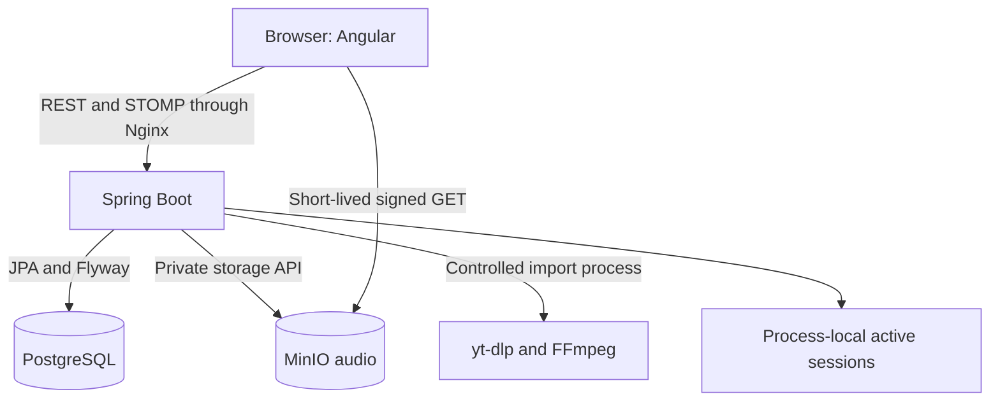

# Architecture

[Up: Project overview](../README.md)

## Current delivered architecture

Blindtest is a monorepo with one Spring Boot backend and one Angular frontend.
It uses a modular monolith rather than independently deployed domain services.
Java packages currently organize controllers, services, models, ports, and adapters;
the domain-oriented package tree in older specifications is a target layout.

Nginx serves the SPA and proxies `/api` and `/ws`. `/media` remains for legacy
files. A host reverse proxy provides public TLS in deployment. MinIO's internal
API endpoint and browser-facing signing endpoint can differ.

## Boundaries and data flow

HTTP controllers and STOMP handlers validate transport input and delegate to
application services. Services coordinate domain rules, repositories, and ports.
The pure game domain has no Spring, database, WebSocket, or storage dependencies.

PostgreSQL retains accounts, catalogue data, import jobs, cleanup tasks, and
completed-game snapshots. Active sessions use immutable snapshots and atomic
versioned updates in a process-local store. A restart ends active sessions; it
does not erase completed history.

Audio bytes live in private object storage. Public catalogue responses do not
provide private object keys or internal answer aliases. An authorized gameplay
participant receives a short-lived media URL for the current round. Imports and
media deletion cross external boundaries through adapters with explicit failure
handling.

## Explore the current system

| Detail | Responsibility |
|---|---|
| [Backend](backend/README.md) | Request flow, services, ports, security and media |
| [Frontend](frontend/README.md) | Routes, browser state, STOMP, audio and UI |
| [Data and persistence](architecture/data.md) | Durable entities, migrations and session/history separation |
| [Session internals](backend/sessions.md) | Commands, concurrency, timers, completion and expiry |
| [Operations](operations/README.md) | Compose topology, environments and deployment |
| [ADRs](adr/README.md) | Accepted design decisions and trade-offs |

## Target architecture

The [original target design](architecture/target.md) is preserved as small topic
pages. Its multiplayer models, API examples, synchronization plans, and package
layouts are historical intent and may conflict with accepted decisions.
The [roadmap](plan.md) determines scope; source and tests establish implementation.
The [current status](product/status.md) records known gaps and discrepancies.
