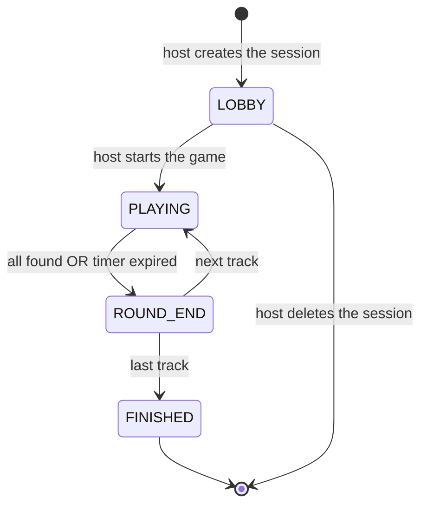
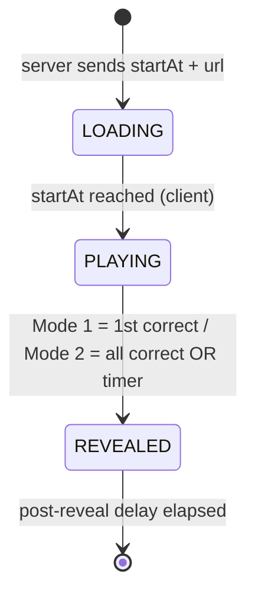
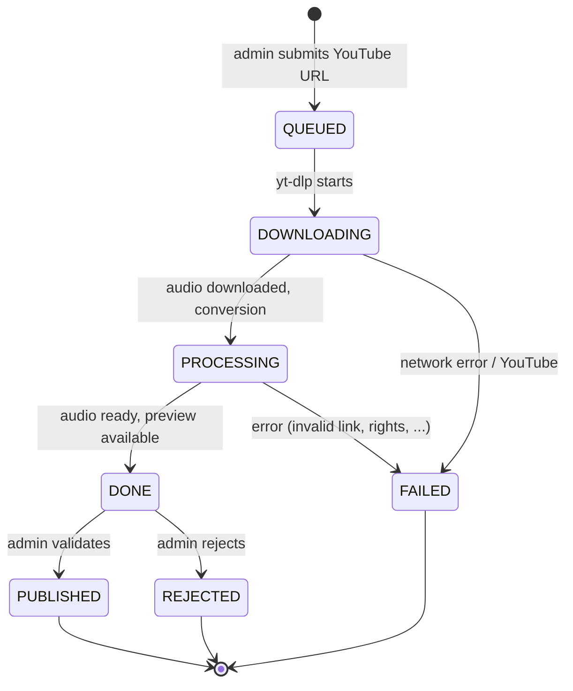
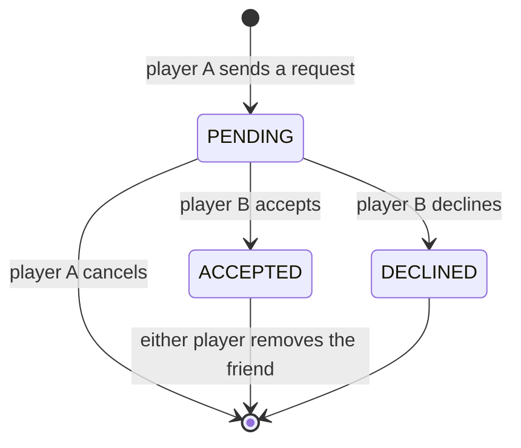
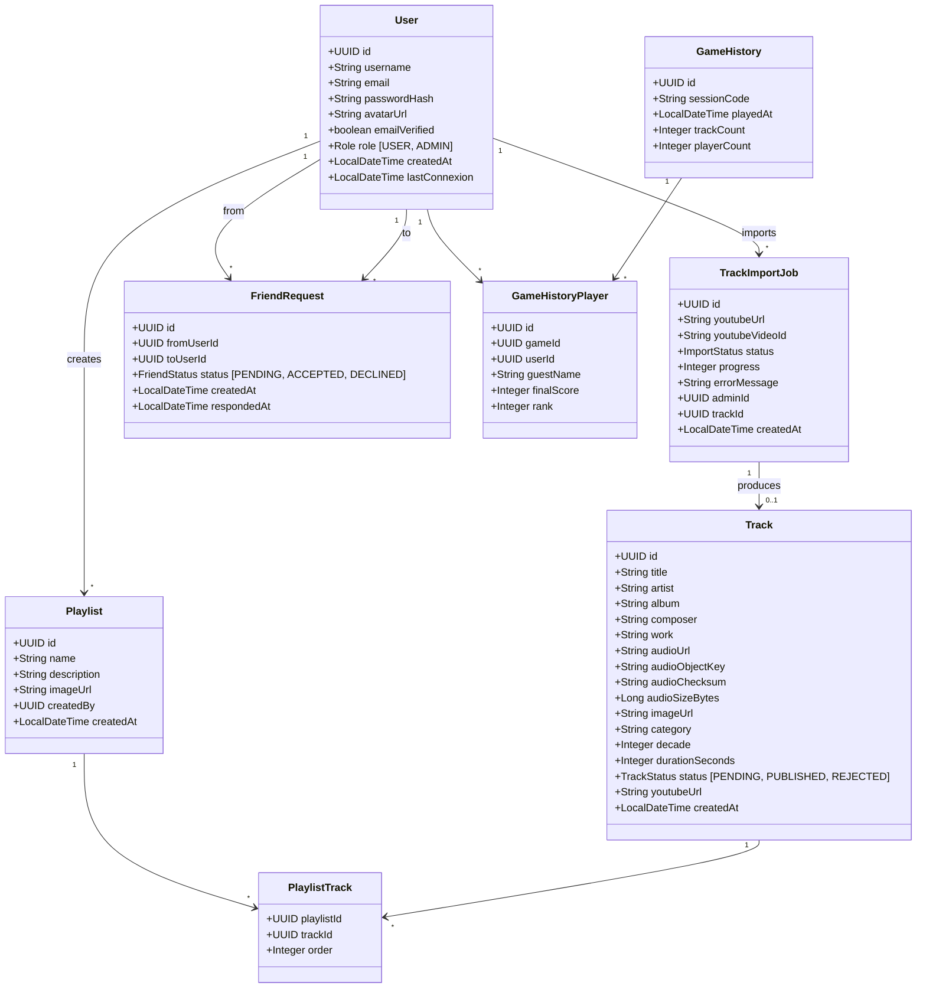
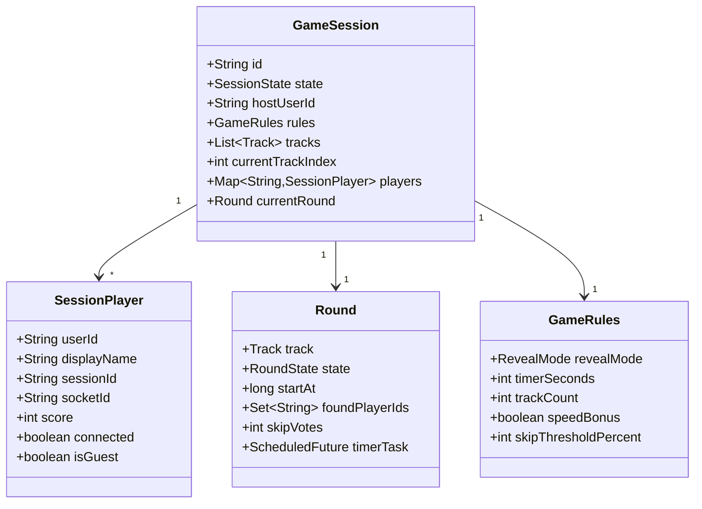
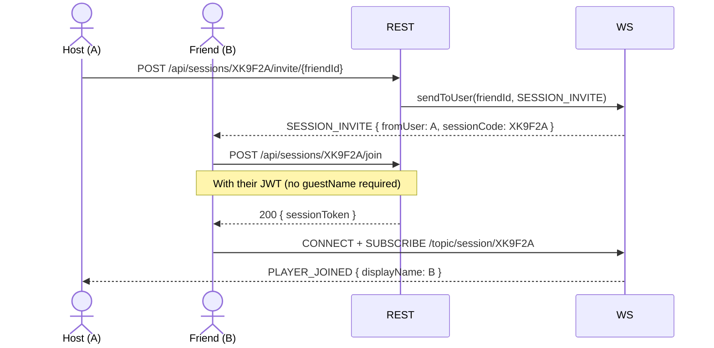
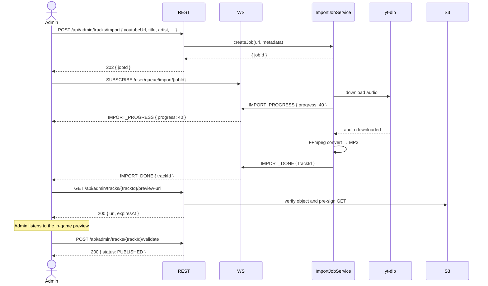
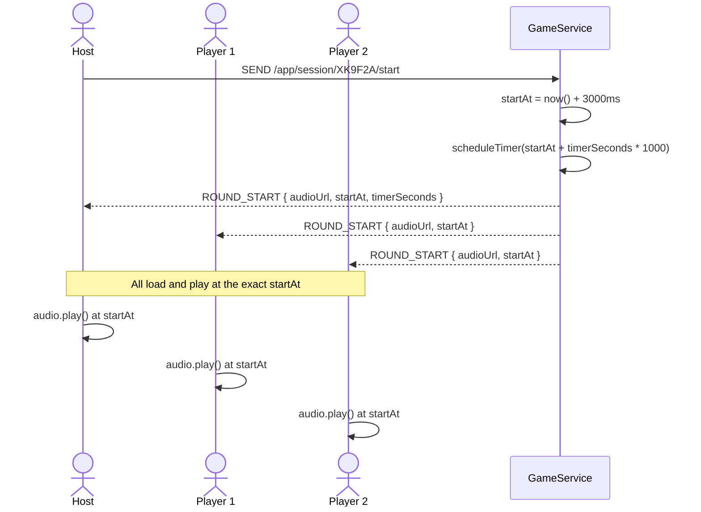

# Blindtest — Technical & Functional Documentation

## Document Status

This document contains two deliberately separate views:

- **Current delivered architecture** describes what is present in executable code
  and migrations as reviewed on 2026-07-27.
- **Target architecture** preserves the original product design in sections 1–13.
  It contains planned and deferred features and must not be used as proof that an
  endpoint, model, screen, or behavior has been implemented.

When documents disagree, executable code and tests come first, followed by
database migrations and the validated decisions in [`plan.md`](plan.md). The plan
is the delivery authority. `swagger.yaml`, the target sections below, diagrams,
and UI references describe intent until code and tests deliver it.

## Table of Contents

- [Current Delivered Architecture](#current-delivered-architecture)
- [Target Architecture](#target-architecture)
  1. [Overview](#1-overview)
  2. [Functional Specifications](#2-functional-specifications)
  3. [Tech Stack](#3-tech-stack)
  4. [General Architecture](#4-general-architecture)
  5. [Data Model](#5-data-model)
  6. [REST API](#6-rest-api)
  7. [WebSocket / STOMP](#7-websocket--stomp)
  8. [Sequence Diagrams](#8-sequence-diagrams)
  9. [Backend Architecture (Spring Boot)](#9-backend-architecture-spring-boot)
  10. [Frontend Architecture (Angular)](#10-frontend-architecture-angular)
  11. [Audio Synchronization (Option 2)](#11-audio-synchronization-option-2)
  12. [Music Import Workflow](#12-music-import-workflow)
  13. [Security & Auth](#13-security--auth)

## Current Delivered Architecture

The repository is a modular monorepo:

```text
Browser
  └── Nginx / Angular SPA (`frontend`)
        ├── /api and /ws ──> Spring Boot (`backend`)
        │                     ├── JPA / Flyway ──> PostgreSQL
        │                     └── MediaStorage ──> MinIO
        └── /media ─────────> shared Docker volume
```

Docker Compose starts PostgreSQL, MinIO, a one-shot MinIO initializer, the backend,
and the frontend. The frontend, MinIO API, and MinIO console bind to localhost;
PostgreSQL remains internal. The initializer creates the private media bucket and
MinIO restricts API CORS to the configured application origin. The `/media` volume
remains temporarily for legacy tracks during the migration window.

### Delivered backend

- Java 21 and Spring Boot 3.2 with Spring Security, JPA, Flyway, and STOMP.
- Registration with Turnstile, email verification, login, rotating opaque refresh
  tokens, logout, and password reset.
- Public published-track and playlist catalogue endpoints with deterministic
  ordering, bounded metadata search, safe public projections, and `Cache-Control:
  public, max-age=60, stale-while-revalidate=300`.
- Administrator track review, asynchronous YouTube import jobs, per-user STOMP
  import progress, and ordered playlist management.
- Imports accept only HTTPS YouTube watch, short-link, and Shorts URLs with
  canonical 11-character video IDs. Equivalent active imports are rejected.
- Imported MP3s are validated in isolated temporary directories, checksummed,
  uploaded under content-addressed private object keys, confirmed, and cleaned up
  before jobs complete.
- External email, Turnstile, process, and import-scheduling boundaries exposed as
  injectable ports, with injected authentication time and opaque-token generation.
- Deterministic test adapters capture email, verify configured Turnstile tokens,
  execute imports synchronously, and write a small MPEG Layer III fixture without
  Resend, Cloudflare, YouTube, `yt-dlp`, or FFmpeg.
- A provider-neutral private-media port supports upload, existence checks,
  short-lived GET URLs, and deletion. Its production adapter uses the MinIO Java
  SDK with typed internal endpoint, public endpoint, region, bucket, credentials,
  and URL lifetime settings; tests can replace it with an in-memory adapter.
- PostgreSQL entities and Flyway migrations for users, refresh tokens, tracks,
  playlists, playlist membership, import jobs, and safe first-administrator
  provisioning audit records.
- A pure `model/game` boundary validates immutable playlist, requested-track-count,
  and maximum-round-duration configuration snapshots. It consumes only an immutable
  playlist-eligibility projection, rejects every reserved extension for V1, and
  exposes stable domain errors without Spring, JPA, or transport dependencies. The
  backend-authoritative limits are 5–30 tracks and 10–60 seconds in five-second
  increments, with defaults of 15 tracks and 30 seconds.
- The same pure game boundary uniformly samples eligible published playlist tracks
  without replacement and independently shuffles their play order through an
  injectable random port. Selected tracks retain detached canonical and alternative
  answers, playback metadata, and private-media object key/checksum versions; a
  cryptographic production adapter and deterministic seeded tests keep the policy
  unpredictable in production and reproducible in tests.
- JWT authentication for HTTP requests and STOMP `CONNECT` frames.
- A non-web operator command promotes one existing verified account when no
  administrator exists. Pessimistic database locking makes concurrent attempts
  safe; repeated promotion of the sole administrator is idempotent. Normal
  registration always creates a `USER`. The production procedure is documented
  in [`admin-provisioning.md`](admin-provisioning.md).

The delivered REST surface is limited to `/api/auth/**`, `/api/tracks`,
`/api/playlists/**`, `/api/admin/tracks/**`,
`/api/admin/tracks/import/**`, and `/api/admin/playlists/**`.

### REST errors and correlation

All delivered REST error paths, including Spring Security and malformed requests,
return the same JSON shape:

```json
{
  "timestamp": "2026-07-27T17:00:00Z",
  "status": 400,
  "code": "VALIDATION_FAILED",
  "message": "Request validation failed",
  "path": "/api/auth/login",
  "requestId": "2a4e1208-72f3-4a14-a8d5-f2e36c8f24f8",
  "fieldErrors": {
    "email": "must be a well-formed email address"
  }
}
```

`fieldErrors` is present only for field validation failures. Clients must branch
on the stable `code`, not on `message`. Exception messages, stack traces, rejected
values, tokens, and provider details are never copied into the response.

Every HTTP response carries the same ID in the `X-Request-ID` header. A valid UUID
received in that request header is reused; missing or malformed values are replaced
with a generated UUID. The ID is stored in SLF4J MDC and included in application
log lines. The complete code enumeration and reusable response definitions are in
[`swagger.yaml`](swagger.yaml).

### Delivered frontend

Angular 21 currently implements the authentication pages and infrastructure:
login, registration, email verification, forgot/reset password, route protection,
JWT interception, refresh, and local session state. The administrator area delivers
the track catalogue, YouTube import workflow, and playlist editor. Playlist editing
supports metadata, published-track search, add/remove operations, drag-and-keyboard
ordering with rollback on failure, and unsaved-change navigation protection. The
authenticated game-configuration page lists eligible public playlists, previews
their published tracks, filters out playlists with fewer than five eligible tracks,
and saves bounded track-count and round-duration choices as a local draft. Its controls
share the backend's approved limits and defaults. It does not create a server session
yet. Other non-auth feature components remain route scaffolds whose templates are
placeholders.

### Not delivered

There is no session or round state model, `SessionStore`, gameplay controller,
gameplay STOMP handler, answer normalization or matching, scoring/timer logic,
synchronized playback, game history, profile management, friends, guest joining,
or admin user management.
The private-media port, MinIO SDK adapter and deployment, database object-key
schema, and import-pipeline integration are delivered. Legacy media can still use
the Docker volume and `/media` URLs during migration.

The non-root backend runtime image installs pinned `yt-dlp` and FFmpeg versions
and verifies both binaries while building. Import execution applies a configurable
wall-clock deadline and temporary-file-size ceiling, limits FFmpeg to one worker
thread, and inherits the backend container CPU quota. A timeout or oversized
workspace terminates the process tree and marks the import failed.
Import requests enforce database-aligned metadata bounds and canonicalize
supported YouTube URL forms before creating a job. A partial unique PostgreSQL
index prevents concurrent active jobs for the same video. The process receives a
fixed argument list with an option terminator and an application-owned output
path inside a newly created import directory; symlink or non-regular output is
rejected. Provider and infrastructure exception details are replaced with stable
safe failure messages before persistence, WebSocket delivery, or logging.

Full-stack adapter tests import
`DeterministicTestAdaptersConfig`. Production continues to use `EmailService`,
`TurnstileService`, `AsyncImportJobScheduler`, the `ProcessBuilder` factory, a UTC
system clock, UUID-backed opaque refresh tokens, and `MinioMediaStorage`. The
MinIO adapter keeps SDK types below the service port and uses separate clients for
private storage operations and browser-accessible URL signing.
Testcontainers exercises that adapter against the pinned MinIO API for upload,
existence, recursive listing, pre-signing, HTTP byte-range reads, retry-safe
overwrite/deletion, and unavailable-storage translation. Playwright independently
verifies that Chromium can seek through a range-capable audio response.
Track catalogue responses are immutable scalar metadata snapshots. `title` is
always the canonical primary answer (film title for film-related tracks, music
title otherwise); album, composer, work, category, decade, duration, and image are
nullable secondary metadata. Publication requires nonblank title and artist plus
either a legacy audio URL or a complete object key/checksum/positive-size tuple.
Administrators manage alternative title, artist, composer, and album answers
through dedicated per-track CRUD endpoints. Alias responses expose only their ID,
type, and display value; an internal Unicode/case/whitespace key rejects
duplicates without defining the later gameplay matching rules. Tracks also store
an administrator-configured whole-second playback offset, defaulting to zero.
Publication of a non-zero offset requires a known duration with at least 60
seconds remaining.
Administrators request previews through
`GET /api/admin/tracks/{trackId}/preview-url`; the application verifies a pending
track, a completed import, finalized media metadata, and object existence before
returning the pre-signed URL and its expiration. Signed URLs and object keys are
not written to application logs or persistent API data.
Track deletion and media replacement write obsolete object keys to a durable
`media_deletion_outbox` row in the same transaction as the reference change. A
bounded scheduled worker deletes objects idempotently and retains failed tasks
with exponential backoff. Administrators can run read-only reconciliation through
`GET /api/admin/media/reconciliation`; it reports track IDs and truncated key
fingerprints rather than exposing internal keys. Aggregate pending, success,
failure, missing, and orphan counts are available through the administrator-only
Actuator metrics endpoint. Operational response steps are documented in
[`media-operations.md`](media-operations.md).
Persistence-generated entity IDs remain database-owned; tests consume returned
IDs instead of predicting them.

## Target Architecture

Sections 1–13 below are the original target specification. Some catalogue and
authentication capabilities overlap with delivered code, while gameplay,
multiplayer, social, history, and several administration capabilities remain
planned or deferred. Accepted technical decisions are indexed under
[`adr/`](adr/README.md); they override conflicting target details below. The
roadmap determines when target behavior becomes delivery scope.

---

## 1. Overview

The target product is a real-time multiplayer music blindtest web application.

- A **host** starts a session and configures the game
- **Players** join via a short code or a friend invite (no account required)
- Music plays synchronously across all clients
- Scores and reveals are broadcast in real time
- **Administrators** manage the music catalogue and platform playlists

---

## 2. Functional Specifications

### 2.1 User Roles

| Role | Description | Account required |
|---|---|---|
| **Host** | Creates and controls the game session (start, skip, etc.) | Yes |
| **Registered Player** | Persistent profile, friend system, game history | Yes |
| **Guest Player** | Temporary account valid for the duration of the session | No |
| **Administrator** | Manages the music catalogue and platform playlists | Yes (role `ADMIN`) |

### 2.2 User Stories

**Account Management**
- As a user, I want to register with a verified email (via Cloudflare)
- As a user, I want to log in and personalise my profile (username, avatar, password)

**Friend System**
- As a registered player, I want to search for other players by username
- As a registered player, I want to send/receive/accept/decline friend requests
- As a registered player, I want to remove a friend
- As a host, I want to invite a friend directly into my lobby without sharing the code
- As a player, I want to receive a real-time notification when a friend invites me to a session

**Session Creation**
- As a host, I want to create a session and get a shareable short code
- As a host, I want to configure the rules: reveal mode, timer duration, number of tracks
- As a host, I want to choose the music (playlist, category, decade)
- As a host, I want to start the game when all players are ready
- As a host, I want to invite my friends directly from the lobby

**Joining a Session**
- As a player, I want to join a session with a 6-character code
- As a guest player, I want to choose a username without creating an account
- As a registered player, I want to join a friend's session via a notification

**Gameplay**
- As a player, I want to hear the music at the same time as everyone else
- As a player, I want to submit my answer (title / artist)
- As a player, I want to see in real time who found the answer
- As a player, I want to vote to skip the track
- As a player, I want to see the live score

**History**
- As a registered player, I want to view my game history
- As a player, I want to see the details of a past game (scores, tracks played)
- As a player, I want to view another player's public history

**Catalogue Management (Administrator)**
- As an administrator, I want to import a track by pasting a YouTube link
- As an administrator, I want to fill in metadata: title, artist, album, composer,
  work, category, decade, duration, and image
- As an administrator, I want to preview the in-game rendering before validating
- As an administrator, I want to validate or reject an imported track
- As an administrator, I want to create and edit themed playlists
- As an administrator, I want to add/remove tracks from a playlist

**Reveal Modes**

| Mode | Behaviour |
|---|---|
| **Mode 1** | As soon as a player finds the answer, the title is revealed to all |
| **Mode 2** | The title is revealed when everyone has found it OR when the timer expires |

### 2.3 State Machine — Session



### 2.4 State Machine — Round



### 2.5 State Machine — Music Import



Publication and rejection are idempotent terminal actions and are accepted only
from `DONE`. The REST status endpoint is the recovery source after a missed private
WebSocket event. Rejected media remains private and retained until DG-05 defines
its deletion period.

### 2.6 State Machine — Friend Request



---

## 3. Tech Stack

### Backend

| Component | Technology |
|---|---|
| Language | Java 21 |
| Framework | Spring Boot 3.x |
| WebSocket | Spring WebSocket + STOMP |
| Security | Spring Security + JWT (jjwt) |
| Persistence | Spring Data JPA + Hibernate |
| Database | PostgreSQL 16 |
| Mail | Spring Mail + SMTP |
| Audio import | yt-dlp (external process) + FFmpeg |
| Build | Maven |

### Frontend

| Component | Technology |
|---|---|
| Framework | Angular 17+ (standalone components) |
| WebSocket | @stomp/rx-stomp |
| State | RxJS (BehaviorSubject / signals) |
| UI | Angular Material + TailwindCSS |
| Audio | Web Audio API (native) |
| HTTP | Angular HttpClient |

### Infrastructure

```
Browser ──HTTPS──► Nginx (reverse proxy)
                       │
                 ┌─────┴──────┐
                 │            │
           Angular SPA   Spring Boot
           (static)      :8080
                              │
                         PostgreSQL
                         :5432
                              │
                         /media (audio files)
```

---

## 4. General Architecture

```
┌──────────────────────────────────────────────────────────────────────┐
│                          FRONTEND (Angular)                          │
│                                                                      │
│  ┌──────────┐  ┌──────────┐  ┌──────────┐  ┌──────┐  ┌──────────┐  │
│  │  Auth    │  │  Lobby   │  │   Game   │  │ End  │  │  Admin   │  │
│  │  Module  │  │  Module  │  │  Module  │  │Screen│  │  Module  │  │
│  └────┬─────┘  └────┬─────┘  └────┬─────┘  └──┬───┘  └────┬─────┘  │
│       └──────────────┴─────────────┴────────────┴───────────┘        │
│                 StompService  +  AuthService  +  FriendService        │
└──────────────────────────────┬───────────────────────────────────────┘
                               │ WS (STOMP) + REST (HTTPS)
┌──────────────────────────────┼───────────────────────────────────────┐
│                    BACKEND (Spring Boot)                             │
│                                                                      │
│  ┌──────────────────┐  ┌────────────────────────────────────────┐   │
│  │  REST Controllers │  │           WebSocket / STOMP            │   │
│  │  /api/auth        │  │  /ws  (STOMP endpoint)                 │   │
│  │  /api/sessions    │  │  /app/**   (client → server)          │   │
│  │  /api/users       │  │  /topic/** (server → group)           │   │
│  │  /api/tracks      │  │  /user/queue/** (server → 1 client)  │   │
│  │  /api/playlists   │  └────────────────────────────────────────┘   │
│  │  /api/admin/**    │                                               │
│  └──────────────────┘                                               │
│  ┌─────────────────────────────────────────────────────────────────┐ │
│  │   AuthService │ SessionService │ GameService │ FriendService    │ │
│  │   TrackService │ ImportJobService │ PlaylistService             │ │
│  └─────────────────────────────────────────────────────────────────┘ │
│  ┌────────────────────────────┐  ┌───────────────────────────────┐   │
│  │  SessionStore              │  │  ScheduledExecutorService     │   │
│  │  (ConcurrentHashMap)       │  │  (round timers)               │   │
│  └────────────────────────────┘  └───────────────────────────────┘   │
│  ┌─────────────────────────────────────────────────────────────────┐ │
│  │              Spring Data JPA → PostgreSQL                       │ │
│  │              YtDlpWrapper → yt-dlp (process) → /media          │ │
│  └─────────────────────────────────────────────────────────────────┘ │
└──────────────────────────────────────────────────────────────────────┘
```

---

## 5. Data Model

### 5.1 Persisted Entities (PostgreSQL)



### 5.2 In-Memory Objects (active sessions)



---

## 6. REST API

> See `docs/swagger.yaml` for the full specification with schemas, examples and error codes.

Base URL: `/api`

### Auth

| Method | Endpoint | Description | Auth |
|---|---|---|---|
| POST | `/auth/register` | Register | No |
| POST | `/auth/login` | Login, returns JWT | No |
| POST | `/auth/logout` | Invalidates the refresh token | JWT |
| POST | `/auth/refresh` | Refreshes the JWT | Cookie |
| POST | `/auth/verify-email` | Email verification (token) | No |
| POST | `/auth/forgot-password` | Sends a password reset email | No |
| POST | `/auth/reset-password` | Resets the password | No |

### Users

| Method | Endpoint | Description | Auth |
|---|---|---|---|
| GET | `/users/me` | Full profile of the logged-in user | JWT |
| PATCH | `/users/me` | Update username / avatar / password | JWT |
| DELETE | `/users/me` | Delete account | JWT |
| GET | `/users/{userId}` | Public profile of a user | JWT |
| GET | `/users/search?q=` | Search users by username | JWT |

### Friends

| Method | Endpoint | Description | Auth |
|---|---|---|---|
| GET | `/users/me/friends` | Friend list | JWT |
| DELETE | `/users/me/friends/{userId}` | Remove a friend | JWT |
| GET | `/users/me/friends/requests` | Pending requests (received + sent) | JWT |
| POST | `/users/{userId}/friend-request` | Send a friend request | JWT |
| POST | `/users/me/friends/requests/{requestId}/accept` | Accept a request | JWT |
| POST | `/users/me/friends/requests/{requestId}/decline` | Decline a request | JWT |
| DELETE | `/users/me/friends/requests/{requestId}` | Cancel a sent request | JWT |

### History

| Method | Endpoint | Description | Auth |
|---|---|---|---|
| GET | `/users/me/history` | Game history of the logged-in player | JWT |
| GET | `/users/{userId}/history` | Public history of a player | JWT |
| GET | `/games/{gameId}` | Full details of a game | JWT |

### Sessions

| Method | Endpoint | Description | Auth |
|---|---|---|---|
| POST | `/sessions` | Create a session | JWT |
| GET | `/sessions/{code}` | Public session info | No |
| DELETE | `/sessions/{code}` | Delete the session | JWT (host) |
| POST | `/sessions/{code}/join` | Join (guest: body `{ guestName }`) | Optional |
| POST | `/sessions/{code}/invite/{friendId}` | Invite a friend (WS notification) | JWT (host) |

### Tracks & Playlists (public catalogue)

| Method | Endpoint | Description | Auth |
|---|---|---|---|
| GET | `/tracks?category=&decade=` | Filtered list of published tracks | No |
| GET | `/playlists` | List of available playlists | No |
| GET | `/playlists/{id}` | Playlist detail with its tracks | No |

### Administration — Tracks

| Method | Endpoint | Description | Auth |
|---|---|---|---|
| GET | `/admin/tracks` | All tracks (all statuses) | ADMIN |
| PUT | `/admin/tracks/{id}` | Update track metadata | ADMIN |
| DELETE | `/admin/tracks/{id}` | Delete a track | ADMIN |
| POST | `/admin/tracks/import` | Start a YouTube track import | ADMIN |
| GET | `/admin/tracks/import/{jobId}` | Import job status | ADMIN |
| POST | `/admin/tracks/{id}/validate` | Validate and publish the track | ADMIN |
| POST | `/admin/tracks/{id}/reject` | Reject the track | ADMIN |

### Administration — Playlists

| Method | Endpoint | Description | Auth |
|---|---|---|---|
| GET | `/admin/playlists` | All playlists | ADMIN |
| POST | `/admin/playlists` | Create a playlist | ADMIN |
| GET | `/admin/playlists/{id}` | Playlist detail | ADMIN |
| PUT | `/admin/playlists/{id}` | Update a playlist | ADMIN |
| DELETE | `/admin/playlists/{id}` | Delete a playlist | ADMIN |
| POST | `/admin/playlists/{id}/tracks` | Add a track to the playlist | ADMIN |
| DELETE | `/admin/playlists/{id}/tracks/{trackId}` | Remove a track | ADMIN |
| PUT | `/admin/playlists/{id}/tracks/order` | Atomically replace the complete track order | ADMIN |

Playlist positions are contiguous and zero-based. Only published tracks may be
added, duplicate membership is rejected, and an order replacement must contain
every current track ID exactly once. Playlist rows are locked while membership is
changed, and the database enforces non-negative unique positions. Rejecting or
deleting a published track removes it from every playlist and compacts the
remaining positions in the same transaction. Public and administrator playlist
details expose published tracks only.

### Administration — Users

| Method | Endpoint | Description | Auth |
|---|---|---|---|
| GET | `/admin/users` | User list | ADMIN |
| PATCH | `/admin/users/{userId}` | Update a user (role, status) | ADMIN |
| DELETE | `/admin/users/{userId}` | Delete a user | ADMIN |

---

## 7. WebSocket / STOMP

### Connection

```
URL: ws://host/ws
Protocol: STOMP 1.2
Header: Authorization: Bearer <JWT or sessionToken>
```

Native WebSocket clients connect to `/ws`. SockJS clients use the separate
`/ws-sockjs` fallback endpoint.

### Subscription Topics (server → clients)

| Topic | Recipients | Content |
|---|---|---|
| `/topic/session/{code}` | All players in a session | Game events |
| `/user/queue/notifications` | 1 connected user | Invitations, friend requests |
| `/user/queue/private` | 1 user (ACK, errors) | Private messages |
| `/user/queue/import/{jobId}` | 1 admin | Import progress |

### Send Destinations (client → server)

| Destination | Description |
|---|---|
| `/app/session/{code}/start` | Host starts the game |
| `/app/session/{code}/answer` | Submit an answer `{ text }` |
| `/app/session/{code}/vote-skip` | Vote to skip |
| `/app/session/{code}/next` | Host skips manually |

### Game Event Types (`/topic/session/{code}`)

| Type | Trigger |
|---|---|
| `PLAYER_JOINED` | A player joins the lobby |
| `PLAYER_LEFT` | A player leaves |
| `GAME_STARTED` | The game starts |
| `ROUND_START` | New round (contains `audioUrl` + `startAt`) |
| `PLAYER_FOUND` | A player found the answer |
| `ROUND_REVEALED` | Reveal of the correct answer + scores |
| `ROUND_END` | End of round |
| `SKIP_VOTE` | Skip vote update |
| `GAME_FINISHED` | End of game |

### Notification Events (`/user/queue/notifications`)

| Type | Payload |
|---|---|
| `SESSION_INVITE` | `{ fromUser, sessionCode, sessionState }` |
| `FRIEND_REQUEST` | `{ fromUser, requestId }` |
| `FRIEND_REQUEST_ACCEPTED` | `{ byUser }` |

### Import Events (`/user/queue/import/{jobId}`)

| Type | Payload |
|---|---|
| `IMPORT_PROGRESS` | `{ jobId, status, progress }` |
| `IMPORT_DONE` | `{ jobId, trackId }`; the admin then requests an authorized preview URL |
| `IMPORT_FAILED` | `{ jobId, errorMessage }` |

---

## 8. Sequence Diagrams

### 8.1 Friend Invite to a Session



### 8.2 Music Import (admin)



### 8.3 Game Start and Audio Synchronization



---

## 9. Backend Architecture (Spring Boot)

### 9.1 Package Structure

```
src/main/java/com/blindtest/
├── config/
│   ├── SecurityConfig.java
│   ├── WebSocketConfig.java
│   └── SchedulerConfig.java
│
├── controller/
│   ├── AuthController.java
│   ├── SessionController.java
│   ├── UserController.java
│   ├── TrackController.java
│   ├── PlaylistController.java
│   └── admin/
│       ├── AdminTrackController.java
│       ├── AdminPlaylistController.java
│       └── AdminUserController.java
│
├── websocket/
│   ├── GameController.java         # @MessageMapping handlers
│   ├── SessionEventPublisher.java
│   └── WebSocketEventListener.java
│
├── service/
│   ├── AuthService.java
│   ├── SessionService.java
│   ├── GameService.java
│   ├── FriendService.java
│   ├── TrackService.java
│   ├── PlaylistService.java
│   ├── ImportJobService.java       # orchestrates yt-dlp + FFmpeg
│   ├── NotificationService.java    # WS push to /user/queue/notifications
│   └── EmailService.java
│
├── store/
│   └── SessionStore.java           # ConcurrentHashMap<String, GameSession>
│
├── model/
│   ├── entity/
│   │   ├── UserEntity.java
│   │   ├── TrackEntity.java
│   │   ├── PlaylistEntity.java
│   │   ├── PlaylistTrackEntity.java
│   │   ├── TrackImportJobEntity.java
│   │   ├── FriendRequestEntity.java
│   │   ├── GameHistoryEntity.java
│   │   └── GameHistoryPlayerEntity.java
│   ├── session/                    # in-memory objects (non-JPA)
│   │   ├── GameSession.java
│   │   ├── SessionPlayer.java
│   │   ├── Round.java
│   │   └── GameRules.java
│   ├── game/                       # pure validated configuration and game rules
│   └── dto/
│       ├── request/
│       └── response/
│
├── security/
│   ├── JwtTokenProvider.java
│   └── JwtAuthFilter.java
│
├── infra/
│   └── YtDlpWrapper.java           # yt-dlp + FFmpeg process
│
└── repository/
    ├── UserRepository.java
    ├── TrackRepository.java
    ├── PlaylistRepository.java
    ├── TrackImportJobRepository.java
    ├── FriendRequestRepository.java
    └── GameHistoryRepository.java
```

---

## 10. Frontend Architecture (Angular)

### 10.1 Module Structure

```
src/app/
├── core/
│   ├── services/
│   │   ├── auth.service.ts
│   │   ├── stomp.service.ts
│   │   ├── audio.service.ts
│   │   ├── friend.service.ts
│   │   └── notification.service.ts  # listens to /user/queue/notifications
│   ├── guards/
│   └── interceptors/
│
├── features/
│   ├── auth/
│   ├── lobby/
│   │   ├── create-session/
│   │   ├── join-session/
│   │   └── lobby-room/
│   │       └── friend-invite/       # friend invite UI
│   ├── game/
│   │   ├── game-room/
│   │   ├── audio-player/
│   │   ├── answer-form/
│   │   ├── scoreboard/
│   │   └── player-list/
│   ├── profile/
│   │   ├── my-profile/
│   │   └── game-history/
│   ├── friends/
│   │   ├── friend-list/
│   │   └── friend-requests/
│   ├── end-screen/
│   └── admin/
│       ├── track-list/
│       ├── track-import/            # YouTube form + preview
│       ├── playlist-editor/
│       └── user-management/
│
└── shared/
    ├── components/
    │   └── notification-toast/      # invitations, friend requests
    └── models/
```

---

## 11. Audio Synchronization (Option 2 — detail)

### Principle

```
Server                          Clients
   │                               │
   │  startAt = now() + 3000ms     │
   │──── ROUND_START ─────────────►│
   │                               │ audio.load(url)
   │                               │ setTimeout(play, startAt - Date.now())
   │  scheduleRoundEnd(startAt     │
   │    + timerSeconds * 1000)     │ audio.play() ← exactly at startAt
```

```typescript
schedulePlay(audioUrl: string, startAt: number): void {
  this.audio.src = audioUrl;
  this.audio.load();

  const delay = startAt - Date.now();
  if (delay <= 0) {
    this.audio.currentTime = Math.abs(delay) / 1000;
    this.audio.play();
  } else {
    setTimeout(() => { this.audio.currentTime = 0; this.audio.play(); }, delay);
  }
}
```

| Case | Behaviour |
|---|---|
| Arrival after `startAt` | Immediate play with `currentTime = lag / 1000` |
| Reconnection mid-round | Server sends `ROUND_START` with original `startAt` + `elapsed` |
| Slow network | 3s buffer absorbs typical latencies |

---

## 12. Music Import Workflow

1. The admin pastes the YouTube URL into the form
2. **POST** `/api/admin/tracks/import` → the server creates a `TrackImportJob` and responds `202 { jobId }`
3. The admin subscribes to `/user/queue/import/{jobId}` to track progress
4. The server runs `yt-dlp` in the background to extract bounded metadata and
   download the audio, then FFmpeg converts it to MP3 and generates at most 800
   normalized waveform peaks from a bounded mono PCM stream
5. Once done, the `IMPORT_DONE` event contains `jobId` and `trackId`
6. The frontend requests `GET /api/admin/tracks/{trackId}/preview-url` and
   `GET /api/admin/tracks/{trackId}/waveform` once, draws the waveform as SVG, then
   immediately seeks and plays whenever the admin moves or clicks the start selector
7. The admin corrects the extracted metadata when necessary, previews the 60-second
   selection window, and saves it through the track endpoint
8. The admin validates (**POST** `/api/admin/tracks/{id}/validate`) → `status = PUBLISHED`
   or rejects (**POST** `/api/admin/tracks/{id}/reject`) → `status = REJECTED`
9. Only `PUBLISHED` tracks are available in the catalogue for sessions

```java
// YtDlpWrapper.java (simplified)
public Path downloadAudio(String youtubeUrl, UUID jobId) throws IOException {
    Path outputPath = mediaDir.resolve(jobId + ".%(ext)s");
    ProcessBuilder pb = new ProcessBuilder(
        "yt-dlp", "-x", "--audio-format", "mp3",
        "-o", outputPath.toString(),
        youtubeUrl
    );
    Process process = pb.start();
    // read stdout for progress, notify via WS
    int exit = process.waitFor();
    if (exit != 0) throw new ImportException("yt-dlp failed");
    return mediaDir.resolve(jobId + ".mp3");
}
```

---

## 13. Security & Auth

### Registration Flow
```
1. POST /api/auth/register { email, username, password, turnstileToken }
2. Turnstile token verification against the Cloudflare API (siteverify)
3. Account created (emailVerified = false)
4. Email sent with signed token (TTL 24h)
5. POST /api/auth/verify-email { token } → emailVerified = true
```

### Cloudflare Turnstile (anti-bot)
The Turnstile widget is displayed on the registration form. The frontend obtains a `turnstileToken` client-side, which is sent in the `POST /auth/register` request. The backend calls `https://challenges.cloudflare.com/turnstile/v0/siteverify` with the secret key and token before any account creation. A `TurnstileService` encapsulates this HTTP call. The secret key is injected via the `CLOUDFLARE_TURNSTILE_SECRET_KEY` environment variable.

### JWT
- **Access token**: TTL 15 min
- **Refresh token**: TTL 7 days (HttpOnly cookie)
- **Session token** (guest): TTL = session lifetime

### Answer Validation (anti-cheat)
Comparison is done **server-side only** with normalisation + Levenshtein distance ≤ 2.

### WebSocket Authorization
The `JwtAuthFilter` validates the token in the STOMP `CONNECT` header. Each `@MessageMapping` verifies that the `Principal` belongs to the target session.

---

*v2.0 — 2026-05-13*
