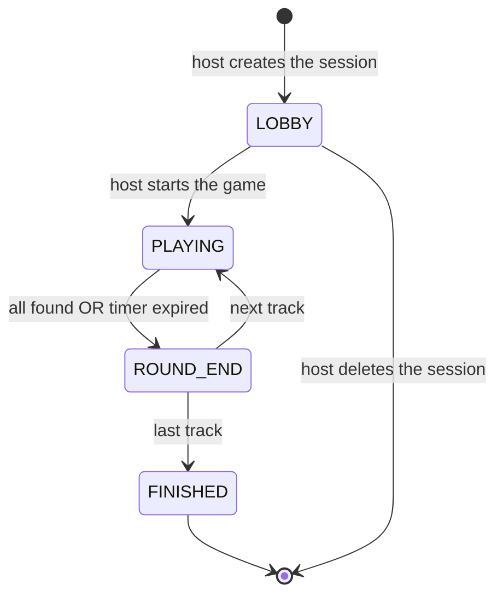
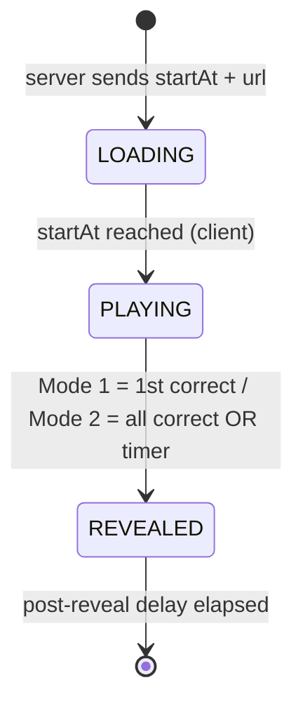
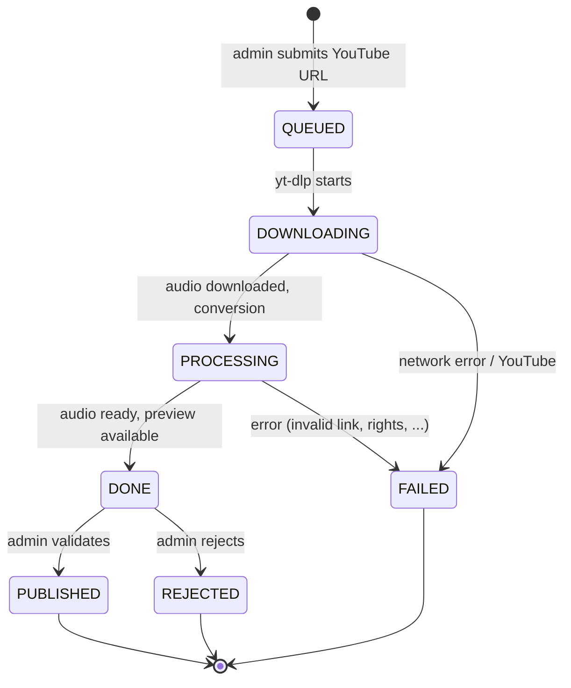
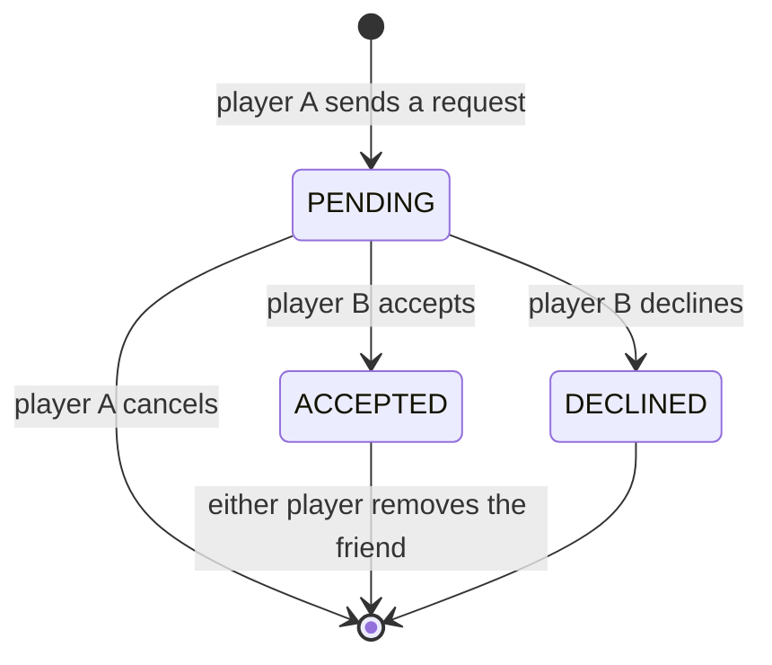

# 2. Functional Specifications

[Up: Target design](../target.md)

Historical target design, not an implementation reference. Validated roadmap
decisions and executable code take precedence. See [current architecture](../../architecture.md).

### 2.1 User Roles

| Role | Description | Account required |
|---|---|---|
| **Host** | Creates and controls the game session (start, skip, etc.) | Yes |
| **Registered Player** | Persistent profile, friend system, game history | Yes |
| **Guest Player** | Temporary account valid for the duration of the session | No |
| **Administrator** | Manages the music catalogue and platform playlists | Yes (role `ADMIN`) |

### 2.2 User Stories

**Account Management**
- As a user, I want to register with a verified email (via Cloudflare)
- As a user, I want to log in and personalise my profile (username, avatar, password)

**Friend System**
- As a registered player, I want to search for other players by username
- As a registered player, I want to send/receive/accept/decline friend requests
- As a registered player, I want to remove a friend
- As a host, I want to invite a friend directly into my lobby without sharing the code
- As a player, I want to receive a real-time notification when a friend invites me to a session

**Session Creation**
- As a host, I want to create a session and get a shareable short code
- As a host, I want to configure the rules: reveal mode, timer duration, number of tracks
- As a host, I want to choose the music (playlist, category, decade)
- As a host, I want to start the game when all players are ready
- As a host, I want to invite my friends directly from the lobby

**Joining a Session**
- As a player, I want to join a session with a 6-character code
- As a guest player, I want to choose a username without creating an account
- As a registered player, I want to join a friend's session via a notification

**Gameplay**
- As a player, I want to hear the music at the same time as everyone else
- As a player, I want to submit my answer (title / artist)
- As a player, I want to see in real time who found the answer
- As a player, I want to vote to skip the track
- As a player, I want to see the live score

**History**
- As a registered player, I want to view my game history
- As a player, I want to see the details of a past game (scores, tracks played)
- As a player, I want to view another player's public history

**Catalogue Management (Administrator)**
- As an administrator, I want to import a track by pasting a YouTube link
- As an administrator, I want to fill in metadata: title, artist, album, composer,
  work, category, decade, duration, and image
- As an administrator, I want to preview the in-game rendering before validating
- As an administrator, I want to validate or reject an imported track
- As an administrator, I want to create and edit themed playlists
- As an administrator, I want to add/remove tracks from a playlist

**Reveal Modes**

| Mode | Behaviour |
|---|---|
| **Mode 1** | As soon as a player finds the answer, the title is revealed to all |
| **Mode 2** | The title is revealed when everyone has found it OR when the timer expires |

### 2.3 State Machine — Session

### 2.4 State Machine — Round

### 2.5 State Machine — Music Import

Publication and rejection are idempotent terminal actions and are accepted only
from `DONE`. The REST status endpoint is the recovery source after a missed private
WebSocket event. Rejected media remains private and retained until DG-05 defines
its deletion period.

### 2.6 State Machine — Friend Request

---
