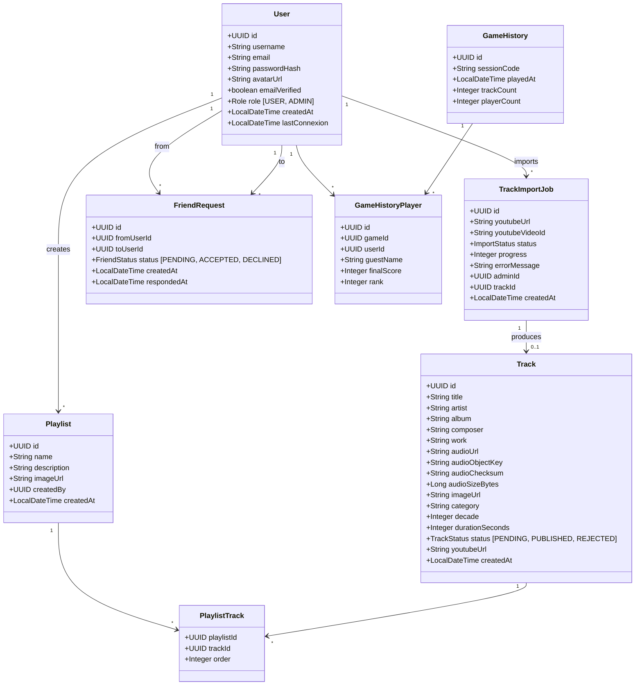
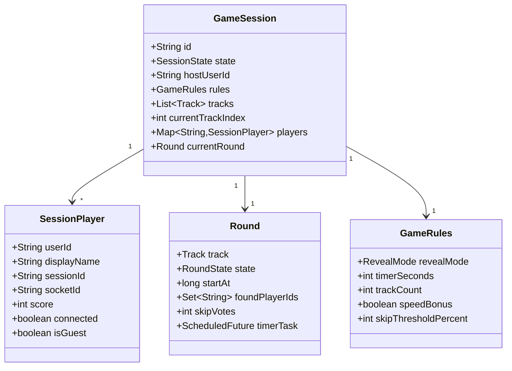

# 5. Data Model

[Up: Target design](../target.md)

Historical target design, not an implementation reference. Validated roadmap
decisions and executable code take precedence. See [current architecture](../../architecture.md).

### 5.1 Persisted Entities (PostgreSQL)

### 5.2 In-Memory Objects (active sessions)

---
