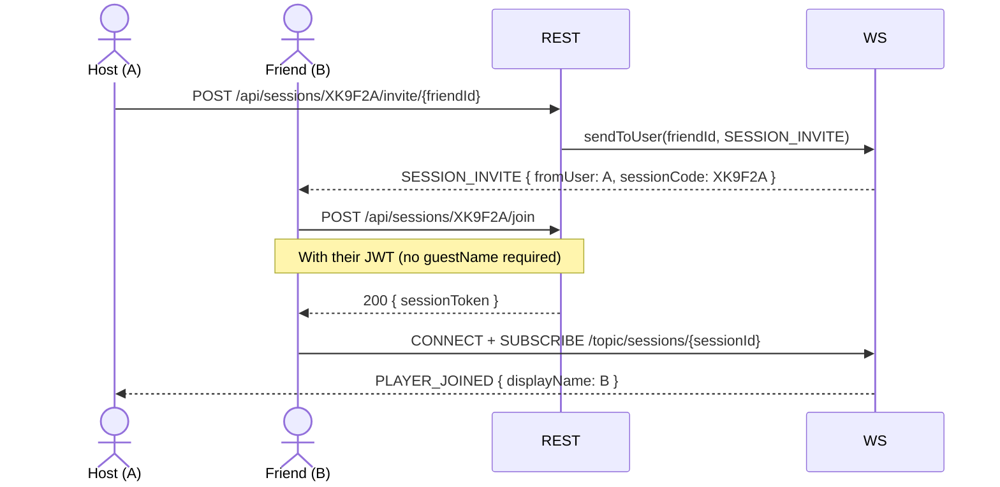
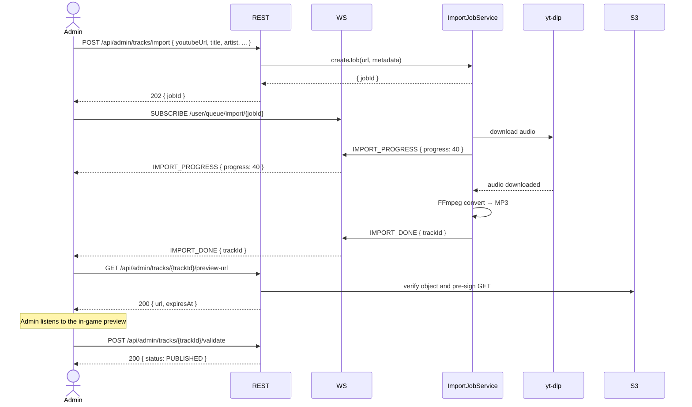
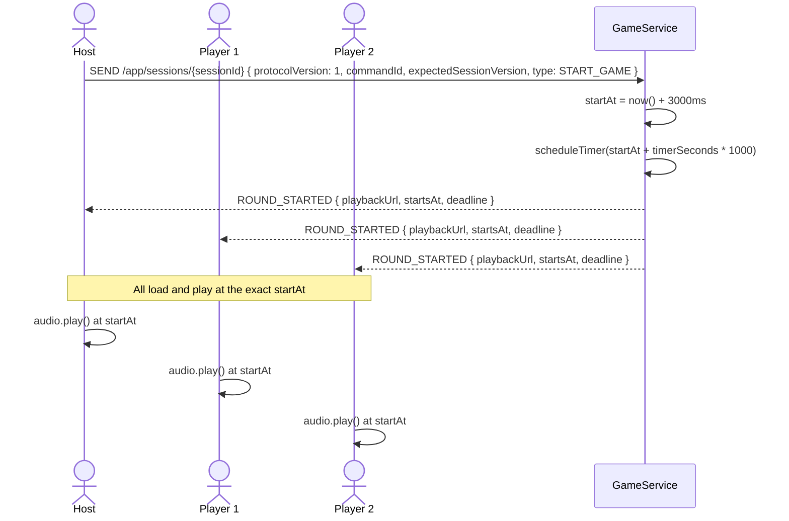

# 8. Sequence Diagrams

[Up: Target design](../target.md)

Historical target design, not an implementation reference. Validated roadmap
decisions and executable code take precedence. See [current architecture](../../architecture.md).

### 8.1 Friend Invite to a Session

### 8.2 Music Import (admin)

### 8.3 Game Start and Audio Synchronization

---
